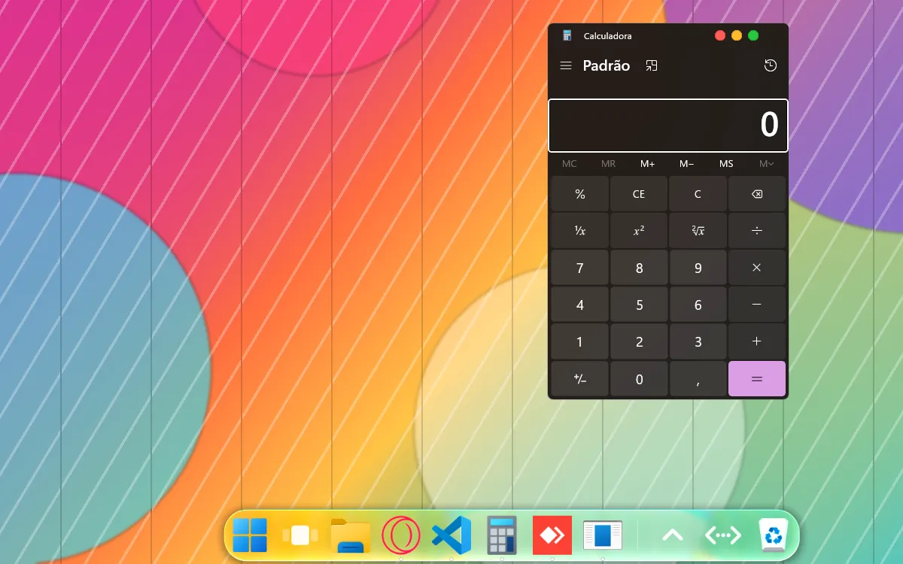
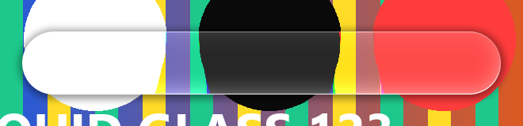
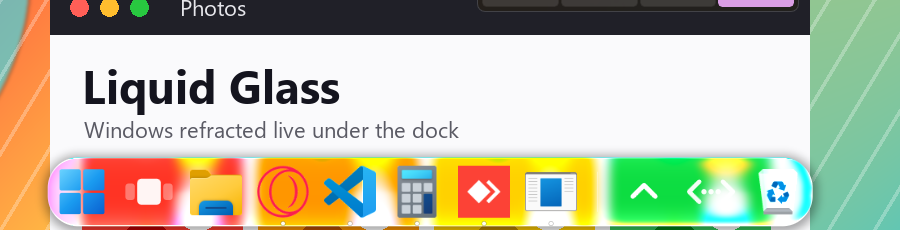
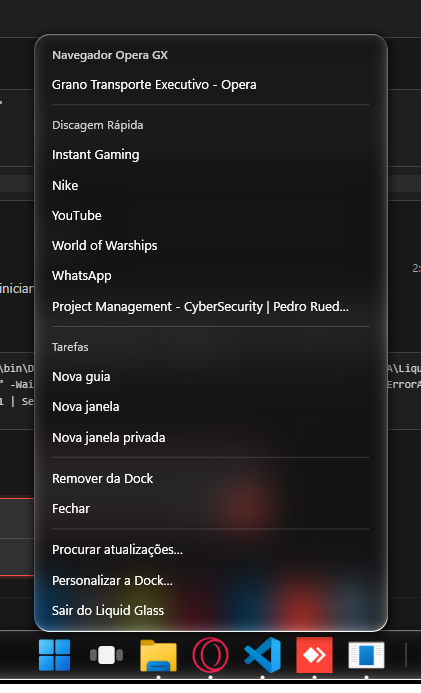
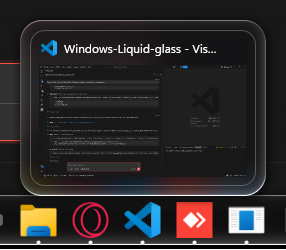
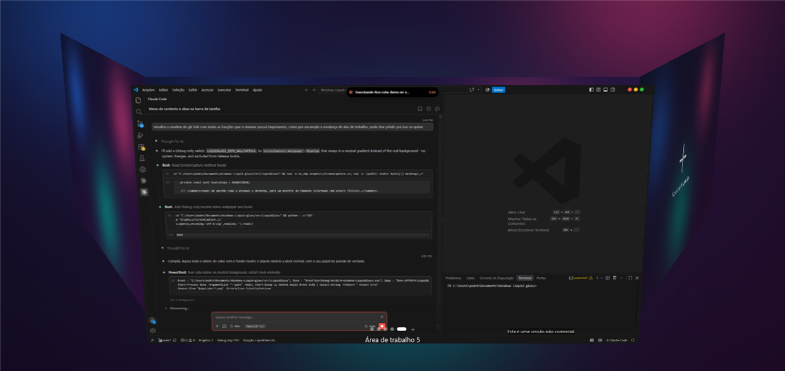
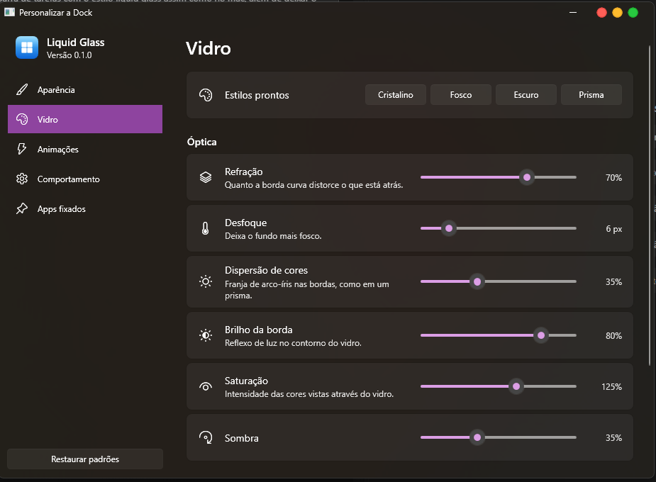

<div align="center">

# Liquid Glass Dock

**A macOS-style *Liquid Glass* dock with truly refracting glass that replaces the Windows 11
taskbar.**

[](https://github.com/PedroRuedas/Windows-Liquid-glass/releases/latest)
[](https://github.com/PedroRuedas/Windows-Liquid-glass/releases)
[](https://github.com/PedroRuedas/Windows-Liquid-glass/actions/workflows/ci.yml)
[](LICENSE)


### [⬇️ Download for Windows 11](https://github.com/PedroRuedas/Windows-Liquid-glass/releases/latest)

[Features](#features) · [Installation](#installation) · [FAQ](#faq) · [Contributing](#contributing) ·
[Changelog](CHANGELOG.md) · [🇧🇷 Português](README.md)



</div>

> The dock speaks English and Brazilian Portuguese: it follows the Windows display language, and
> you can pick one under Customize → Behavior → Language.

Liquid Glass Dock replaces the taskbar with glass that genuinely refracts your wallpaper, macOS-style
icon magnification, launch animations, its own Start menu, virtual desktops on a 3D cube and a full
live customization window. Free, open source, and no administrator rights needed to install.

**Highlights**
- Real liquid glass: a pixel shader bends the wallpaper at the edges, like a lens.
- Live backdrop: windows that pass under the dock show up refracted in the glass, in real time.
- A complete taskbar: pinned and running apps, live window thumbnails, jump lists ("New tab",
  "New incognito window"), system tray, network and battery.
- Virtual desktops on a 3D cube (Win+Tab), with animated switching and windows you can drag from one
  desktop to another.
- "Magic lamp" minimize into the dock icon, and windows that shrink away when closed.
- Updates itself from GitHub releases and uses almost nothing while idle.

## Features

**Liquid glass**
- Real refraction: an HLSL pixel shader bends the wallpaper at the edges, like a lens.
- **Live backdrop:** when a window goes under the dock (dragged there, or maximized with "Reserve
  space for the dock" turned off), the glass shows and bends its content in real time, like the
  macOS Dock. With no window underneath, it goes back to the wallpaper.
- Chromatic aberration, specular rim highlight, tint, saturation and shadow.
- Smooth edges at any corner radius, from square corners to a pill shape.
- Presets: *Crystal*, *Frosted*, *Dark* and *Prism*.





**Icon animations**
- macOS-style magnification: the icon under the cursor grows and its neighbours follow on a smooth
  curve, keeping the point under the mouse fixed.
- Bounce while an app launches, and an attention bounce when a background app needs you.
- Icons animate in and out of the dock and darken when pressed.
- Adjustable animation speed.

**Taskbar behaviour**
- Pinned and running apps, grouped by application (Microsoft Store apps included).
- Click opens the app, brings its window forward, minimizes it or cycles through its windows.
- Middle click opens a new window; right click shows open windows, actions and the app's jump list,
  just like the Windows taskbar.
- **Window thumbnails:** hover a running app to see a live thumbnail of each of its windows. Click
  one to bring it forward; the X or middle click closes it. With many windows, thumbnails wrap and
  shrink until they all fit on screen.
- Drag shortcuts or programs onto the dock to pin them, and drag icons to reorder them. Both
  orders are remembered across restarts, and dragging an open app among the pinned ones pins it.
- **Glass Start menu:** the Start button and the Windows key open a dock menu with search (apps,
  Settings pages and indexed files), pinned apps (imported from the Windows Start menu the first
  time), recent files and an alphabetical **All apps** list. The footer shows your account name and a power button: lock, sign out,
  sleep, hibernate (when enabled in Windows), shut down and restart. You can switch back to the
  Windows Start menu in the settings.
- **Background apps:** a button opens a panel with the system tray icons; left and right clicks
  are forwarded to the app, as in the Windows tray.
- Maximized windows stop at the dock, and the dock hides during fullscreen games and videos.
- Optional auto-hide; the dock can sit at the bottom, left or right of the screen.
- **Network** and **battery** indicators (battery only on devices that have one).

| Jump list on right click | Window thumbnails |
| --- | --- |
|  |  |

**Virtual desktops on a cube, like Fedora (GNOME's Desktop Cube extension)**
- Win+Tab (or the dock button) pulls the camera back and shows your desktops as faces of a cube,
  with windows floating in front of the blurred wallpaper.

  

- Drag to spin the cube; on release it snaps to the nearest desktop, with momentum. Arrow keys and
  the mouse wheel rotate one face; click a face to enter it. A "+" face always creates a new desktop.
- Drag a window off its desktop and drop it on another face to move it there.
- **Close a desktop:** the glass "×" on the front face's corner, the Delete key or a middle-click on
  a face. Its windows move to the neighbouring desktop, as in Task View; the last desktop stays.
- **Switch desktops:** Ctrl+Win+← and → spin the cube to the neighbouring desktop without opening
  the overview.

**More**
- **Badges and progress:** unread counts that Discord, Telegram, Teams and other apps show on the
  Windows taskbar appear on the icon corner, and downloads get a progress bar under the icon.
- **Media controls:** while Spotify, a browser or another player is playing, the app's thumbnails
  show the artwork, title and previous / play-pause / next buttons.
- **Stacks:** a pinned folder opens as a grid of its most recent files, like macOS Stacks.
- **Keyboard shortcuts:** Win+1…9 open the app at that position in the dock; add Shift for a new
  window.
- **Custom icons:** right-click → "Change icon…" accepts an image (PNG, ICO, JPG) or another
  program's icon.
- **Multiple monitors:** "Dock on all monitors" puts a dock on every screen, each with its own
  wallpaper in the glass.
- **Theme:** the glass can follow the Windows light/dark mode or accent color.

**Customization**



Every change shows up on the dock immediately: position, length, icon size (16–96 px), spacing,
corner radius, labels, indicators, glass style and every glass parameter, every animation, auto-hide,
the Windows taskbar mode (hidden, auto-hide or visible), start with Windows, updates and pinned apps.

## Installation

**Requirements:** Windows 11, 64-bit. Animated desktop switching (Ctrl+Win+← / →) uses an interface
available from Windows 11 24H2; on earlier versions that shortcut stays with Windows.

1. Download `LiquidGlassDock-Setup-<version>.exe` from the
   [latest release](https://github.com/PedroRuedas/Windows-Liquid-glass/releases/latest).
2. Run it. The installer is not code-signed yet, so Windows will likely show "Windows protected your
   PC": click **More info → Run anyway**. To verify the file, compare
   `Get-FileHash .\LiquidGlassDock-Setup-<version>.exe` in PowerShell with the SHA-256 published in
   the release.

The installer is per-user (no administrator prompt), bundles everything it needs (no .NET install
required), enables "Start with Windows" by default and adds "Liquid Glass Dock" and "Quit Liquid Glass Dock"
shortcuts to the Start menu.

**Updates:** the dock checks GitHub releases on launch and every 6 hours. When a new version is out,
right-click anywhere on the dock and choose the update: it downloads the installer, verifies the
SHA-256 published by GitHub, installs and restarts itself. Nothing is installed without asking.

**Uninstall** from Settings → Apps. The uninstaller quits the dock, restores the Windows taskbar and
removes the startup entry.

## Building from source

Requirements: Windows 11 and the .NET 10 SDK.

```powershell
dotnet run --project src/LiquidGlass                         # run the dock
dotnet test                                                  # run the tests
dotnet publish src/LiquidGlass -p:PublishProfile=Installer   # build the installer into artifacts/
```

| Command | Effect |
| --- | --- |
| `LiquidGlass.exe` | Starts the dock (or opens customization if it's already running) |
| `LiquidGlass.exe --settings` | Starts and opens customization |
| `LiquidGlass.exe --quit` | Quits the dock and restores the taskbar (even after a forced shutdown) |

## How it works

DWM blur covers the whole rectangle of a transparent window, which rules out rounded corners and
refraction. So the dock draws its own glass:

1. `WallpaperService` captures the wallpaper exactly as Windows draws it (`PaintDesktop`) and blurs
   it in the background.
2. `LiquidGlassSurface` crops the part of the wallpaper behind it on screen.
3. `LiquidGlassEffect` (`Effects/Shaders/LiquidGlass.fx`) computes the shape with a signed distance
   field and offsets sampling near the edge, like a lens, plus dispersion, highlight, tint and shadow.

With no window behind the glass, that's all: nothing is captured continuously. When a window enters
the dock area, `LiveBackdrop` asks Windows for that window's image (Windows.Graphics.Capture,
without the yellow border), copies only the part behind the glass from the GPU, blends it over the
wallpaper and blurs it, at half resolution on its own thread. Because the dock reads windows one by
one rather than the screen, it never captures itself and still shows up normally in screenshots
and recordings. Measured with a window moving underneath: ~1.4 ms per frame and under 1% CPU.
Direct3D is only created while a window is underneath and released 15 s after it leaves.

When idle for 3 seconds, the dock enters Windows' efficiency mode (EcoQoS) and returns to normal as
soon as the cursor reaches it. Measured idle: 0.00 s of CPU time over 20 s, ~115 MB private memory.

## FAQ

**The Windows taskbar is gone and the dock isn't running. What now?**
Open "Quit Liquid Glass Dock" from the Start menu (or run `LiquidGlass.exe --quit`). The original
taskbar state is saved before hiding it and is restored on exit, on errors and after a forced
shutdown.

**Does it work on Windows 10?** No, the installer requires Windows 11.

**Can I go back to the Windows Start menu or taskbar?** Yes, both are options under
Customize → Behavior, and everything goes back to normal when the dock quits.

## Contributing

Bug reports, ideas and pull requests are welcome, in English or Portuguese. See the
[contributing guide](CONTRIBUTING.md), the [security policy](SECURITY.md) and the
[code of conduct](CODE_OF_CONDUCT.md).

If you like the dock, a ⭐ helps other people find it.

## Code signing policy

Free code signing provided by [SignPath.io](https://about.signpath.io), certificate by
[SignPath Foundation](https://signpath.org) (application in progress; until it is approved,
releases are unsigned).

- **Committers, reviewers and approvers:** [PedroRuedas](https://github.com/PedroRuedas),
  maintainer. Outside contributions are accepted only through reviewed pull requests.
- **Build:** installers are produced only by the [release workflow](.github/workflows/release.yml)
  on GitHub-hosted runners, from a tag of the public source. No binary built on a personal machine
  is signed.
- **Privacy:** this program does not transfer any information to other networked systems, except
  for checking GitHub releases (`api.github.com`) for a new version when it starts and every 6 hours
  (this can be turned off under Customize → Behavior) and downloading the installer when you ask
  for an update. No personal data is sent.

## License

Liquid Glass Dock is licensed under the [GNU General Public License v3.0](LICENSE).

Third-party: [ManagedShell](https://github.com/cairoshell/ManagedShell) (Apache-2.0),
[CommunityToolkit.Mvvm](https://github.com/CommunityToolkit/dotnet) (MIT),
[Vortice.Windows](https://github.com/amerkoleci/Vortice.Windows) (MIT). The installer is built
with [Inno Setup](https://jrsoftware.org/isinfo.php).
