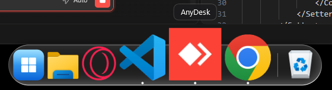
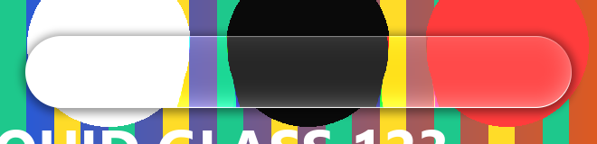
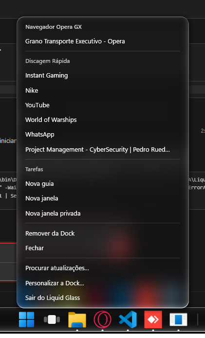
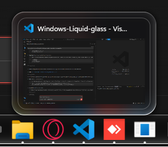
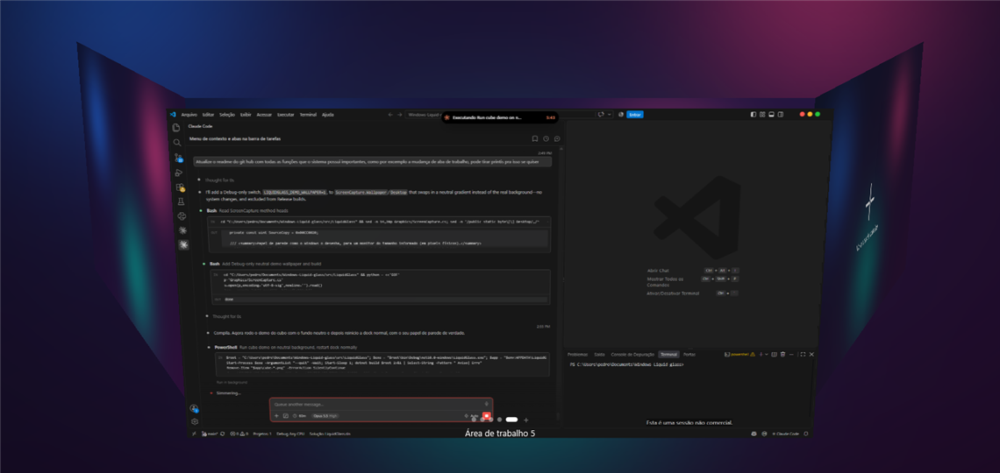
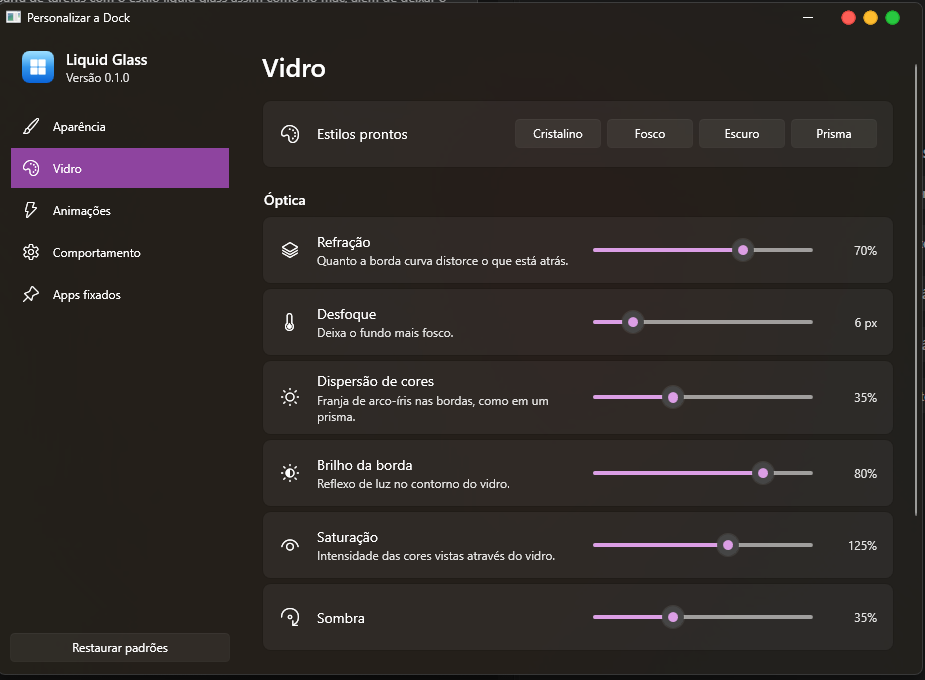

<div align="center">

# Liquid Glass Dock

**A dock no estilo *Liquid Glass* do macOS, com vidro que refrata de verdade, no lugar da barra de
tarefas do Windows 11.**

[](https://github.com/PedroRuedas/Windows-Liquid-glass/releases/latest)
[](https://github.com/PedroRuedas/Windows-Liquid-glass/releases)
[](https://github.com/PedroRuedas/Windows-Liquid-glass/actions/workflows/ci.yml)
[](LICENSE)


### [⬇️ Baixar para Windows 11](https://github.com/PedroRuedas/Windows-Liquid-glass/releases/latest)

[Recursos](#recursos) · [Instalação](#instalação) · [Perguntas frequentes](#perguntas-frequentes) ·
[Contribuir](#contribuir) · [Histórico de versões](CHANGELOG.md) · [🇺🇸 English](README.en.md)



</div>

Ela substitui a barra de tarefas com vidro que refrata de verdade o papel de parede, ampliação dos
ícones ao passar o mouse, animações de abertura, menu Iniciar próprio, áreas de trabalho num cubo
3D e uma tela de personalização completa. Gratuita, de código aberto e sem precisar de
administrador para instalar.

**Destaques**
- Vidro líquido de verdade: o papel de parede é curvado nas bordas por um shader, como uma lente.
- Barra de tarefas completa: apps fixados e abertos, miniaturas das janelas, listas de atalhos
  ("Nova guia", "Nova janela anônima"), bandeja do sistema, rede e bateria.
- Áreas de trabalho num cubo 3D (Win+Tab), com troca animada entre áreas e janelas arrastáveis de
  uma área para outra.
- Minimizar em "lâmpada mágica" para dentro do ícone e fechar encolhendo a janela.
- Atualiza sozinha pelas releases do GitHub e gasta quase nada parada.

## Recursos

**Vidro líquido**
- Refração real: um pixel shader HLSL curva o papel de parede nas bordas, como uma lente.
- Dispersão de cores (aberração cromática), brilho especular no contorno, tom, saturação e sombra.
- Bordas suavizadas em qualquer arredondamento, de cantos retos até o formato de pílula.
- Estilos prontos: *Cristalino*, *Fosco*, *Escuro* e *Prisma*.



**Animações dos ícones**
- Ampliação estilo macOS: o ícone sob o cursor cresce e os vizinhos acompanham em curva suave,
  com o ponto sob o mouse sempre fixo.
- Quique enquanto um app abre e quique de atenção quando um app em segundo plano pede atenção.
- Ícones entram e saem da dock com animação; o ícone escurece ao ser pressionado.
- Velocidade das animações ajustável.

**Comportamento de barra de tarefas**
- Apps fixados e apps em execução, agrupados por aplicativo (inclusive apps da Microsoft Store).
- Clique abre o app, traz a janela para frente, minimiza ou alterna entre janelas.
- Clique do meio abre uma nova janela; o botão direito mostra as janelas abertas, as ações e a
  lista de atalhos do app, como na barra do Windows: "Nova guia" e "Nova janela anônima" nos
  navegadores, "Nova janela" e pastas recentes no VS Code, e assim por diante.
- **Miniaturas das janelas:** pare o mouse sobre um app aberto para ver uma miniatura viva de cada
  janela dele (dois VS Codes, por exemplo). Clique numa para trazê-la; o X ou o botão do meio a fecha.
  Com muitas janelas, as miniaturas quebram em linhas e diminuem até todas caberem na tela.
- Arraste atalhos ou programas para a dock para fixá-los.
- **Reordenar ícones:** segure um app e arraste-o para outra posição. Os fixados trocam de lugar
  entre si (a ordem fica salva) e os abertos não fixados, entre si.
- **Menu Iniciar de vidro:** o botão Iniciar e a tecla Windows abrem um menu da dock com pesquisa
  (apps, páginas das Configurações e arquivos do índice do Windows), os apps fixados (trazidos do
  menu Iniciar do Windows na primeira vez) e os arquivos recentes. No rodapé ficam o nome da conta e
  o botão de energia: bloquear, sair, suspender, hibernar (quando ligada no Windows), desligar e
  reiniciar. Dá para trocar de volta para o menu do Windows nas preferências.
- Botão Iniciar e Lixeira.
- **Apps em segundo plano:** um botão abre um painel com os ícones da bandeja do sistema. Clique
  esquerdo e direito são repassados ao app, como na bandeja do Windows.
- Janelas maximizadas param antes da dock, e a dock some em jogos e vídeos em tela cheia.
- Opção de ocultar a dock automaticamente.
- Funciona com a dock embaixo, à esquerda ou à direita da tela.
- **Rede:** ícone de Wi-Fi com a força do sinal e o nome da rede (ou de rede cabeada); o clique
  abre a lista de redes do Windows.
- **Bateria:** carga, tempo restante e estado (carregando, economia de energia) num ícone discreto
  perto da Lixeira. Só aparece em computadores com bateria.

| Lista de atalhos no botão direito | Miniaturas das janelas |
| --- | --- |
|  |  |

**Áreas de trabalho em cubo, como no Fedora (extensão Desktop Cube do GNOME)**
- Win+Tab (ou o botão da dock) afasta a câmera e mostra as áreas de trabalho como faces de um cubo,
  em círculo, com as janelas flutuando à frente do papel de parede desfocado.

  

- Arraste com o mouse para girar o cubo (na vertical ele inclina); ao soltar, ele encaixa na área
  mais próxima, levando em conta o embalo. Setas e roda do mouse giram uma face; clique numa face
  para entrar nela. Sempre há uma face "+": pare nela e clique (ou Enter) para criar uma área; o
  cubo continua aberto e ganha outra face "+", para criar quantas quiser.
- Arraste uma janela para tirá-la da área dela e solte-a em outra face para movê-la para lá (na
  face "+", ela ganha uma área nova). Para chegar a uma área de trás, segure a janela perto da borda
  esquerda ou direita da tela, ou gire com a roda do mouse ou as setas; Esc ou soltar fora do cubo
  devolve a janela. Janelas fixadas em todas as áreas não se arrastam.
- **Trocar de área de trabalho:** Ctrl+Win+← e → giram o cubo até a área vizinha, recuando um pouco
  no meio do giro, sem precisar abrir a visão geral.
- Minimizar é a "lâmpada mágica": a janela escorre em funil para dentro do ícone dela na dock (e se
  desenrola de lá ao restaurar pela dock). Fechar encolhe a janela enquanto ela some.

**Personalização**



Todas as mudanças aparecem na dock na hora:

| Seção | Opções |
| --- | --- |
| Aparência | posição (embaixo, esquerda, direita), comprimento da dock, tamanho dos ícones, espaçamento, distância da borda, arredondamento, rótulos, indicadores, miniaturas das janelas, botão Iniciar, botão das áreas de trabalho, apps em segundo plano, rede, bateria, Lixeira |
| Vidro | estilos prontos, refração, desfoque, dispersão de cores, brilho da borda, saturação, sombra, cor e intensidade do tom |
| Animações | ampliação, tamanho máximo, alcance, quicar ao abrir, quicar por atenção, fechar e minimizar no estilo do GNOME, deslizar entre áreas, velocidade |
| Comportamento | ocultar automaticamente, barra de tarefas do Windows (oculta, auto-ocultar ou visível), iniciar com o Windows, Win+Tab abre as áreas de trabalho, atualizações (procurar, instalar, procurar automaticamente) |
| Apps fixados | adicionar, importar da barra de tarefas, reordenar e remover |

## Atalhos

| Onde | Ação | Efeito |
| --- | --- | --- |
| Ícone de um app | clique | abre o app, traz a janela, minimiza ou alterna entre as janelas dele |
| Ícone de um app | clique do meio | abre uma nova janela |
| Ícone de um app | segurar e arrastar | muda o app de posição na dock |
| Ícone de um app | botão direito | janelas abertas, lista de atalhos do app, fixar, fechar |
| Ícone de um app aberto | parar o mouse | miniaturas das janelas; clique numa para trazê-la |
| Miniatura | X ou clique do meio | fecha a janela |
| Miniaturas abertas | Esc | fecha as miniaturas |
| Qualquer parte da dock | botão direito | atualizar, personalizar, sair |
| Teclado | Win | abre e fecha o menu Iniciar de vidro |
| Menu Iniciar | digitar, ↑ ↓, Enter, Esc | pesquisa, escolhe, abre e fecha |
| App no menu Iniciar | botão direito | fixar ou desafixar do Iniciar, mover para o início |
| Botão de energia do menu Iniciar | clique | bloquear, sair, suspender, hibernar, desligar, reiniciar |
| Teclado | Win+Tab | abre e fecha o cubo das áreas de trabalho |
| Teclado | Ctrl+Win+← / → | vai para a área de trabalho vizinha |
| Cubo | arrastar, setas, roda do mouse | gira o cubo |
| Cubo | clique numa face ou Enter | entra na área (na face "+", cria uma) |
| Cubo | arrastar uma janela até outra face | move a janela para aquela área |
| Cubo | Esc | fecha o cubo (ou devolve a janela arrastada) |

## Instalação

**Requisitos:** Windows 11, 64 bits. A troca animada entre áreas de trabalho (Ctrl+Win+← / →)
usa uma interface do Windows 11 24H2 em diante; nas versões anteriores, esse atalho fica com o
próprio Windows.

1. Baixe `LiquidGlassDock-Setup-<versão>.exe` na
   [última release](https://github.com/PedroRuedas/Windows-Liquid-glass/releases/latest).
2. Execute. O instalador ainda não tem assinatura digital, então o Windows deve mostrar
   "O Windows protegeu o computador": clique em **Mais informações → Executar assim mesmo**.
   Se quiser conferir o arquivo, compare `Get-FileHash .\LiquidGlassDock-Setup-<versão>.exe`
   no PowerShell com o SHA-256 publicado na release.

O instalador:

- instala só para o seu usuário, sem pedir permissão de administrador
  (em `%LocalAppData%\Programs\Liquid Glass Dock`);
- não exige o .NET instalado: o app já vem com tudo o que precisa;
- marca "Iniciar com o Windows" por padrão, para a dock ficar sempre em segundo plano;
- cria no menu Iniciar os atalhos "Liquid Glass Dock" e "Encerrar Liquid Glass Dock";
- encerra a dock que estiver aberta antes de atualizar.

### Atualizar

A dock procura versões novas nas [releases do GitHub](https://github.com/PedroRuedas/Windows-Liquid-glass/releases)
ao abrir e a cada 6 horas. Quando há uma, o botão direito em qualquer parte da dock mostra
"Atualizar para a versão X": a dock baixa o instalador, confere o SHA-256 publicado pelo GitHub,
fecha (devolvendo a barra de tarefas), instala e abre de novo sozinha. O mesmo fica em
Personalizar → Comportamento → Atualizações, onde também dá para desligar a procura automática.
Nada é instalado sem você pedir.

Para desinstalar, use Configurações → Aplicativos. O desinstalador encerra a dock, devolve a
barra de tarefas do Windows e remove a inicialização automática. As preferências em
`%AppData%\LiquidGlass` são mantidas.

### Gerar o instalador

Requisitos: Windows 11 e .NET 10 SDK. O compilador do Inno Setup vem pelo NuGet, sem instalar
nada no sistema.

```powershell
dotnet publish src/LiquidGlass -p:PublishProfile=Installer
```

O instalador sai em `artifacts/`. O Windows SDK (`fxc.exe`) é opcional: o shader compilado já
está no repositório e só é recompilado quando o `.fx` muda.

## Como usar

Para rodar a partir do código:

```powershell
dotnet run --project src/LiquidGlass
```

| Comando | Efeito |
| --- | --- |
| `LiquidGlass.exe` | Inicia a dock (ou abre a personalização se ela já estiver rodando) |
| `LiquidGlass.exe --settings` | Inicia e abre a personalização |
| `LiquidGlass.exe --quit` | Encerra a dock e devolve a barra de tarefas (mesmo depois de um encerramento forçado) |

Também dá para abrir a personalização ou sair pelo botão direito em qualquer parte da dock.

### Consumo em segundo plano

Medido na versão do instalador (Windows 11, monitor de 179 Hz, GeForce RTX 5060):

| | Parada |
| --- | --- |
| CPU | 0,00 s de processador em 20 s |
| Memória privada | ~115 MB |
| Threads | 18 |

Quando ninguém usa a dock por 3 segundos, ela entra no modo de eficiência do Windows (EcoQoS e
prioridade abaixo do normal) e volta ao normal assim que o cursor chega nela. O fundo do vidro é
guardado em meia resolução, já que é desfocado, e a versão publicada é pré-compilada
(ReadyToRun) para não compilar código ao abrir.

O código do app ocupa só ~10 MB de memória. O resto é o motor gráfico e o driver de vídeo, que
qualquer app desenhado pela GPU carrega. Por isso trocar de linguagem economizaria pouco diante
do custo de reescrever tudo.

### A barra de tarefas do Windows sempre volta

Ao esconder a barra nativa, o estado original é salvo em
`%AppData%\LiquidGlass\taskbar-state.json`. Ele é restaurado ao sair, em caso de erro e, se o
processo for encerrado à força, na próxima vez que o app abrir. As preferências ficam em
`%AppData%\LiquidGlass\settings.json`.

## Como funciona

O blur do DWM cobre o retângulo inteiro de uma janela transparente, o que não permite cantos
arredondados nem refração. Por isso a dock desenha o próprio vidro:

1. `WallpaperService` captura o papel de parede exatamente como o Windows o desenha
   (`PaintDesktop`) e aplica um desfoque por caixas em segundo plano.
2. `LiquidGlassSurface` recorta o trecho do papel de parede que está atrás dela na tela.
3. `LiquidGlassEffect` (`Effects/Shaders/LiquidGlass.fx`) calcula a forma por *signed distance
   field* e desloca a amostragem perto da borda, como uma lente, além de dispersão de cores,
   brilho, tom e sombra.

Como a dock reserva espaço na tela, normalmente só o papel de parede fica atrás dela, e o
efeito pode ser calculado sem capturar a tela continuamente. Com isso, a dock também aparece
normalmente em prints.

### Bandeja do sistema

Os ícones da bandeja vêm da [ManagedShell](https://github.com/cairoshell/ManagedShell)
(Apache-2.0), a biblioteca usada pelo RetroBar e pelo Cairo Desktop. Ela registra uma janela de
bandeja própria para receber os ícones dos apps e repassa tudo ao Explorer, então a bandeja nativa
continua completa quando a dock fecha.

## Estrutura

```
src/LiquidGlass/
├── Controls/      MagnifyingPanel (ampliação), DockItemView (animações do ícone),
│                  LiquidGlassSurface, SettingCard
├── Effects/       LiquidGlassEffect + shader HLSL
├── Graphics/      Captura de tela e desfoque por caixas
├── Interop/       Chamadas Win32 (user32, shell32, dwmapi, gdi32, kernel32)
├── Models/        Configurações, apps fixados, presets
├── Services/      Janelas abertas, ícones, papel de parede, bandeja, barra nativa,
│                  app bar, listas de atalhos, áreas de trabalho virtuais, animação
│                  das janelas, atualizações, modo de eficiência, persistência
├── Themes/        Estilos da dock, menus, ícones e da janela de personalização
├── ViewModels/    Dock e personalização (MVVM com CommunityToolkit.Mvvm)
└── Views/         Janela da dock, painel da bandeja, miniaturas das janelas, cubo das
                   áreas de trabalho, lâmpada mágica, personalização, menus, ocultar
                   automaticamente
```

Os testes ficam em `tests/LiquidGlass.Tests` (listas de atalhos, layout das miniaturas e menus).
Os de listas de atalhos gravam uma lista de teste pelo próprio Windows e a apagam no fim:

```powershell
dotnet test
```

O código segue o `.editorconfig` do repositório. O build trata avisos como erros, e o
`dotnet format --verify-no-changes` precisa passar limpo. A [integração contínua](.github/workflows/ci.yml)
roda as três verificações em cada push e pull request.

## Perguntas frequentes

**A barra de tarefas do Windows sumiu e a dock não está aberta. E agora?**
Abra "Encerrar Liquid Glass Dock" no menu Iniciar do Windows (ou rode `LiquidGlass.exe --quit`).
A barra volta mesmo depois de um encerramento forçado. Veja
[A barra de tarefas do Windows sempre volta](#a-barra-de-tarefas-do-windows-sempre-volta).

**Funciona no Windows 10?**
Não. O instalador exige o Windows 11.

**Preciso instalar o .NET?**
Não. O instalador já traz tudo o que a dock precisa.

**A dock pesa no computador?**
Parada, ela não gasta processador e entra no modo de eficiência do Windows. Veja os números em
[Consumo em segundo plano](#consumo-em-segundo-plano).

**Por que o Windows avisa que o instalador é desconhecido?**
Porque ele ainda não tem assinatura digital, que é paga. O código e o processo de build são
públicos, e cada release publica o SHA-256 do instalador, que a própria dock confere ao se
atualizar.

**Posso voltar ao menu Iniciar ou à barra de tarefas do Windows?**
Sim. Em Personalizar → Comportamento dá para mostrar a barra do Windows, e a opção "Menu Iniciar
de vidro" devolve o menu do Windows. Ao fechar a dock, tudo volta ao normal.

## Limitações conhecidas

- O menu Iniciar de vidro não tem "Todos os apps" nem foto do usuário: use a pesquisa para apps
  que não estão fixados.
- A ordem dos fixados do menu Iniciar muda pelo botão direito ("Mover para o início"), não
  arrastando.
- Um app aberto não vira fixado na dock ao ser arrastado para o meio dos fixados, e a ordem dos
  abertos não fixados não é guardada ao reiniciar a dock.
- Os recentes automáticos do Windows (por exemplo, os do Explorador e do Bloco de Notas) não
  entram no menu do botão direito: só as listas que o próprio app registra.
- Janelas fixadas em todas as áreas de trabalho não podem ser arrastadas no cubo.

Encontrou outra? [Abra uma issue](https://github.com/PedroRuedas/Windows-Liquid-glass/issues/new/choose).

## Contribuir

Bugs, ideias e pull requests são bem-vindos. O [guia de contribuição](CONTRIBUTING.md) explica
como preparar o ambiente, rodar os testes e enviar mudanças. Falhas de segurança seguem a
[política de segurança](SECURITY.md), e todos seguem o [código de conduta](CODE_OF_CONDUCT.md).

Se a dock te ajudou, deixe uma ⭐ no repositório: isso ajuda outras pessoas a encontrá-la.

## Licença

Este projeto é distribuído sob a [GNU General Public License v3.0](LICENSE). Você pode usar,
estudar, modificar e redistribuir o código, desde que as versões distribuídas também fiquem
sob a GPL-3.0 e com o código-fonte disponível.

## Licenças de terceiros

- [ManagedShell](https://github.com/cairoshell/ManagedShell): Apache License 2.0
- [CommunityToolkit.Mvvm](https://github.com/CommunityToolkit/dotnet): MIT
- [Inno Setup](https://jrsoftware.org/isinfo.php): gera o instalador (não faz parte do app)
