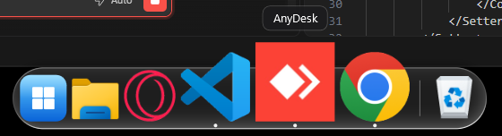
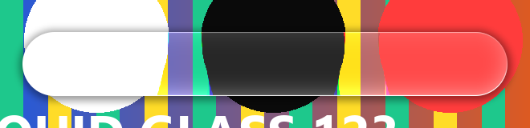
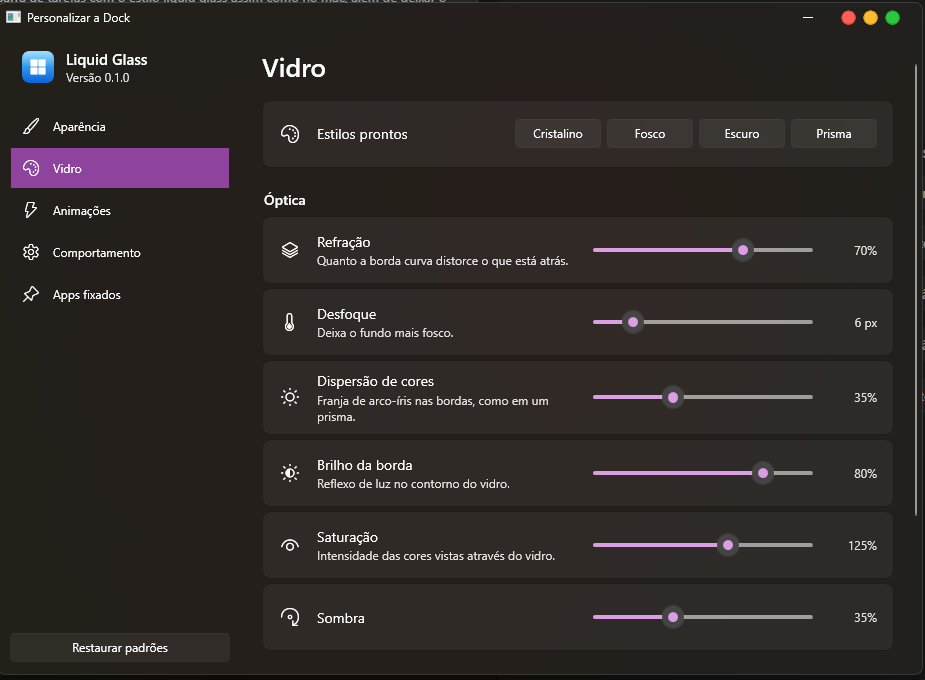

# Liquid Glass Dock

Uma dock para Windows 11 no estilo *Liquid Glass* do macOS. Ela substitui a barra de tarefas
com vidro que refrata de verdade o papel de parede, ampliação dos ícones ao passar o mouse,
animações de abertura e uma tela de personalização completa.



## Recursos

**Vidro líquido**
- Refração real: um pixel shader HLSL curva o papel de parede nas bordas, como uma lente.
- Dispersão de cores (aberração cromática), brilho especular no contorno, tom, saturação e sombra.
- Bordas suavizadas em qualquer arredondamento, de cantos retos até o formato de pílula.
- Estilos prontos: *Cristalino*, *Fosco*, *Escuro* e *Prisma*.



**Animações dos ícones**
- Ampliação estilo macOS: o ícone sob o cursor cresce e os vizinhos acompanham em curva suave,
  com o ponto sob o mouse sempre fixo.
- Quique enquanto um app abre e quique de atenção quando um app em segundo plano pede atenção.
- Ícones entram e saem da dock com animação; o ícone escurece ao ser pressionado.
- Velocidade das animações ajustável.

**Comportamento de barra de tarefas**
- Apps fixados e apps em execução, agrupados por aplicativo (inclusive apps da Microsoft Store).
- Clique abre o app, traz a janela para frente, minimiza ou alterna entre janelas.
- Clique do meio abre uma nova janela; o botão direito mostra as janelas abertas e as ações.
- Arraste atalhos ou programas para a dock para fixá-los.
- Botão Iniciar e Lixeira.
- **Apps em segundo plano:** um botão abre um painel com os ícones da bandeja do sistema. Clique
  esquerdo e direito são repassados ao app, como na bandeja do Windows.
- Janelas maximizadas param antes da dock, e a dock some em jogos e vídeos em tela cheia.
- Opção de ocultar a dock automaticamente.
- **Rede:** ícone de Wi-Fi com a força do sinal e o nome da rede (ou de rede cabeada); o clique
  abre a lista de redes do Windows.
- **Bateria:** carga, tempo restante e estado (carregando, economia de energia) num ícone discreto
  perto da Lixeira. Só aparece em computadores com bateria.

**Áreas de trabalho em cubo, como no Fedora (extensão Desktop Cube do GNOME)**
- Win+Tab (ou o botão da dock) afasta a câmera e mostra as áreas de trabalho como faces de um cubo,
  em círculo, com as janelas flutuando à frente do papel de parede desfocado.
- Arraste com o mouse para girar o cubo (na vertical ele inclina); ao soltar, ele encaixa na área
  mais próxima, levando em conta o embalo. Setas e roda do mouse giram uma face; clique numa face
  para entrar nela. Sempre há uma face "+": pare nela e clique (ou Enter) para criar uma área; o
  cubo continua aberto e ganha outra face "+", para criar quantas quiser.
- Ctrl+Win+setas giram o cubo até a área vizinha, recuando um pouco no meio do giro.
- Minimizar é a "lâmpada mágica": a janela escorre em funil para dentro do ícone dela na dock (e se
  desenrola de lá ao restaurar pela dock). Fechar encolhe a janela enquanto ela some.

**Personalização**



Todas as mudanças aparecem na dock na hora:

| Seção | Opções |
| --- | --- |
| Aparência | posição (embaixo, esquerda, direita), comprimento da dock, tamanho dos ícones, espaçamento, distância da borda, arredondamento, rótulos, indicadores, botão Iniciar, botão das áreas de trabalho, apps em segundo plano, rede, bateria, Lixeira |
| Vidro | estilos prontos, refração, desfoque, dispersão de cores, brilho da borda, saturação, sombra, cor e intensidade do tom |
| Animações | ampliação, tamanho máximo, alcance, quicar ao abrir, quicar por atenção, fechar e minimizar no estilo do GNOME, deslizar entre áreas, velocidade |
| Comportamento | ocultar automaticamente, barra de tarefas do Windows (oculta, auto-ocultar ou visível), iniciar com o Windows, Win+Tab abre as áreas de trabalho |
| Apps fixados | adicionar, importar da barra de tarefas, reordenar e remover |

## Instalação

Rode `LiquidGlassDock-Setup-<versão>.exe`. O instalador:

- instala só para o seu usuário, sem pedir permissão de administrador
  (em `%LocalAppData%\Programs\Liquid Glass Dock`);
- não exige o .NET instalado: o app já vem com tudo o que precisa;
- marca "Iniciar com o Windows" por padrão, para a dock ficar sempre em segundo plano;
- cria no menu Iniciar os atalhos "Liquid Glass Dock" e "Encerrar Liquid Glass Dock";
- encerra a dock que estiver aberta antes de atualizar.

Para desinstalar, use Configurações → Aplicativos. O desinstalador encerra a dock, devolve a
barra de tarefas do Windows e remove a inicialização automática. As preferências em
`%AppData%\LiquidGlass` são mantidas.

### Gerar o instalador

Requisitos: Windows 11 e .NET 10 SDK. O compilador do Inno Setup vem pelo NuGet, sem instalar
nada no sistema.

```powershell
dotnet publish src/LiquidGlass -p:PublishProfile=Installer
```

O instalador sai em `artifacts/`. O Windows SDK (`fxc.exe`) é opcional: o shader compilado já
está no repositório e só é recompilado quando o `.fx` muda.

## Como usar

Para rodar a partir do código:

```powershell
dotnet run --project src/LiquidGlass
```

| Comando | Efeito |
| --- | --- |
| `LiquidGlass.exe` | Inicia a dock (ou abre a personalização se ela já estiver rodando) |
| `LiquidGlass.exe --settings` | Inicia e abre a personalização |
| `LiquidGlass.exe --quit` | Encerra a dock e devolve a barra de tarefas (mesmo depois de um encerramento forçado) |

Também dá para abrir a personalização ou sair pelo botão direito em qualquer parte da dock.

### Consumo em segundo plano

Medido na versão do instalador (Windows 11, monitor de 179 Hz, GeForce RTX 5060):

| | Parada |
| --- | --- |
| CPU | 0,00 s de processador em 20 s |
| Memória privada | ~115 MB |
| Threads | 18 |

Quando ninguém usa a dock por 3 segundos, ela entra no modo de eficiência do Windows (EcoQoS e
prioridade abaixo do normal) e volta ao normal assim que o cursor chega nela. O fundo do vidro é
guardado em meia resolução, já que é desfocado, e a versão publicada é pré-compilada
(ReadyToRun) para não compilar código ao abrir.

O código do app ocupa só ~10 MB de memória. O resto é o motor gráfico e o driver de vídeo, que
qualquer app desenhado pela GPU carrega. Por isso trocar de linguagem economizaria pouco diante
do custo de reescrever tudo.

### A barra de tarefas do Windows sempre volta

Ao esconder a barra nativa, o estado original é salvo em
`%AppData%\LiquidGlass\taskbar-state.json`. Ele é restaurado ao sair, em caso de erro e, se o
processo for encerrado à força, na próxima vez que o app abrir. As preferências ficam em
`%AppData%\LiquidGlass\settings.json`.

## Como funciona

O blur do DWM cobre o retângulo inteiro de uma janela transparente, o que não permite cantos
arredondados nem refração. Por isso a dock desenha o próprio vidro:

1. `WallpaperService` captura o papel de parede exatamente como o Windows o desenha
   (`PaintDesktop`) e aplica um desfoque por caixas em segundo plano.
2. `LiquidGlassSurface` recorta o trecho do papel de parede que está atrás dela na tela.
3. `LiquidGlassEffect` (`Effects/Shaders/LiquidGlass.fx`) calcula a forma por *signed distance
   field* e desloca a amostragem perto da borda, como uma lente, além de dispersão de cores,
   brilho, tom e sombra.

Como a dock reserva espaço na tela, normalmente só o papel de parede fica atrás dela, e o
efeito pode ser calculado sem capturar a tela continuamente. Com isso, a dock também aparece
normalmente em prints.

### Bandeja do sistema

Os ícones da bandeja vêm da [ManagedShell](https://github.com/cairoshell/ManagedShell)
(Apache-2.0), a biblioteca usada pelo RetroBar e pelo Cairo Desktop. Ela registra uma janela de
bandeja própria para receber os ícones dos apps e repassa tudo ao Explorer, então a bandeja nativa
continua completa quando a dock fecha.

## Estrutura

```
src/LiquidGlass/
├── Controls/      MagnifyingPanel (ampliação), DockItemView (animações do ícone),
│                  LiquidGlassSurface, SettingCard
├── Effects/       LiquidGlassEffect + shader HLSL
├── Graphics/      Captura de tela e desfoque por caixas
├── Interop/       Chamadas Win32 (user32, shell32, dwmapi, gdi32, kernel32)
├── Models/        Configurações, apps fixados, presets
├── Services/      Janelas abertas, ícones, papel de parede, bandeja, barra nativa,
│                  app bar, modo de eficiência, persistência
├── Themes/        Estilos da dock, menus, ícones e da janela de personalização
├── ViewModels/    Dock e personalização (MVVM com CommunityToolkit.Mvvm)
└── Views/         Janela da dock, painel da bandeja, personalização, menus, ocultar
                   automaticamente
```

O código segue o `.editorconfig` do repositório. O build trata avisos como erros, e o
`dotnet format --verify-no-changes` precisa passar limpo.

## Licenças de terceiros

- [ManagedShell](https://github.com/cairoshell/ManagedShell): Apache License 2.0
- [CommunityToolkit.Mvvm](https://github.com/CommunityToolkit/dotnet): MIT
- [Inno Setup](https://jrsoftware.org/isinfo.php): gera o instalador (não faz parte do app)
